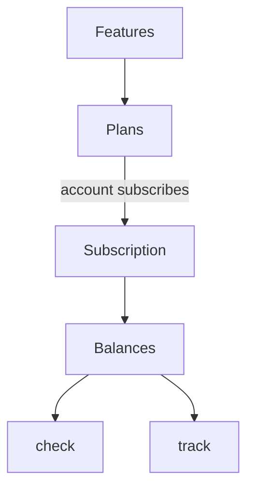

Any product that charges money answers the same questions in the same places. A
pricing page needs your plans and prices. A feature needs to know whether this
account may use it. A usage meter needs a count the customer trusts. An upgrade
needs to know what the rest of the month costs.

Paykit answers those questions from one declaration. You write what you sell in
TypeScript beside your stack. Paykit creates the provider's products and prices
at deploy, keeps each account's balances in your database, and gives your
handlers a check and a track call.

Paykit is a library, not a service. It runs in your deployment, on your database.
A check reads a row you already have instead of calling a billing company, so a
payment provider outage cannot lock your customers out.



## Declare features, plans, and prices

A feature is anything you control access to: messages, seats, SSO. A plan
bundles a price with an allowance of each feature.

```ts title="src/catalog.ts"
import { Paykit } from "@potion.run/paykit";

export const messages = Paykit.feature({ id: "messages", name: "Messages" });

export const free = Paykit.plan({
  id: "free",
  name: "Free",
  grants: [Paykit.planItem(messages, { included: 100 })],
});

export const pro = Paykit.plan({
  id: "pro",
  name: "Pro",
  price: { amount: 1900, currency: "usd", interval: "month" },
  grants: [Paykit.planItem(messages, { included: 2_000, overage: "bill" })],
});
```

The catalog is data. It names no provider ids, so the same declaration sells
through Stripe, Polar or an invoice. The deploy validates it: a plan that grants
a feature nobody declared fails the deploy, not a checkout.

Free plans, usage-based overage, credits, seats, one-off packs, trials, rollovers
and add-ons are all configuration. See [Pricing models](/concepts/pricing-models).

## An account subscribes to a plan

`Paykit.Subscribe(account)` binds the account and returns the verb. The verb
takes the plan:

```ts
const subscribe = yield* Paykit.Subscribe(account);
const result = yield* subscribe({ tier: "pro" });

if ("url" in result) redirect(result.url); // the provider's checkout
if ("activated" in result) return; // a free plan, active now
```

A free plan activates immediately. A priced plan returns a URL for checkout, or
an invoice id when the provider only sends invoices. The subscription activates
when the provider confirms the payment, not when the customer returns from the
checkout page.

See [Subscriptions](/concepts/subscriptions) for the statuses, plan groups and
scheduled changes.

## The plan grants balances

Each plan item becomes a balance for the account: what the plan granted, what the
account used, and what is left. A balance can stack several sources, such as the
plan, an add-on, a rollover and a one-off purchase.

```ts
const balances = yield* Paykit.Balances(account);
const messagesLeft = yield* balances.get({ featureId: "messages" });

messagesLeft.remaining; // units, or null when the plan says unlimited
messagesLeft.breakdown; // one row per source, with its own reset
```

A quantity such as seats reports what was bought and what is occupied instead.
See [Balances](/concepts/balances).

## Your handler checks, then tracks

Before expensive work, ask whether the account may do it. After the work, record
what it consumed. A retry with the same key records one fact:

```ts
const check = yield* Paykit.Check(account);
const { allowed } = yield* check({ featureId: "messages", requiredBalance: 1 });

if (!allowed) return refuse();

// do the work

const track = yield* Paykit.TrackUsage(account);
yield* track({ featureId: "messages", value: 1, idempotencyKey: requestId });
```

When the cost is only known after the work finishes, reserve with a
[hold](/runtime/holds) and settle the real amount. When several requests race for
the last units, `check({ lock: true })` reserves them in the same call.

The check reads one row your database already has. The track appends an event,
and every balance is a fold of those events, so the usage a customer sees and the
money the model recorded come from the same fact.

## The provider moves the money

Stripe or Polar takes the card, calculates tax, sends invoices and retries a
failed payment. `Manual` sends an invoice and takes a transfer.

At deploy, the provider package creates the products, prices and meters the
catalog states, and hands their ids to the Worker. At runtime, a webhook verifies
the delivery with the provider's own decoder and applies the fact. Paykit records
the payment and the refund. It never decides an entitlement from a provider call.

See [Providers](/providers).

## The customer sees the same numbers

A customer's path through your product is short.

1. Your pricing page lists the plans from the deployed catalog.
2. A paid plan sends them to the provider's checkout. A free plan starts at once.
3. The app shows usage from their balances, such as "1,240 of 2,000 messages left".
4. A limit or a plan change shows its price before they confirm.
5. The card and the invoices live in the provider's portal.

The page renders those answers. It never computes a price, so it cannot disagree
with the invoice.

```ts
// The browser reads the plans the deploy recorded, not a second copy.
const LiveCatalog = PaykitCatalogClient("/api/billing/catalog").pipe(
  Layer.provide(FetchHttpClient.layer),
);

const customers = yield* Paykit.Customers(account);
const customer = yield* customers.get();

const preview = yield* Paykit.Preview(account);
const quote = yield* preview({ command: { kind: "changeTier", tier: "scale" } });

quote._tag; // "accepted", "rejected" or "unpredictable"
```

See [Build a billing page](/billing-page).

## What you write

| File | What it states |
| --- | --- |
| `src/catalog.ts` | Features, plans, prices and allowances |
| `src/billing.config.ts` | The catalog, the providers and the store |
| `alchemy.run.ts` | `Paykit.BillingStack`, which validates and records the catalog |
| `src/worker.ts` | `Paykit.world` and `Paykit.handler`, which serve the calls |

Four files, and the catalog is the only one that changes when you change pricing.

## What stays yours

Your session decides who the account is. Your UI decides how to show a plan, a
limit or a refusal. Your provider account owns the money.

Paykit supplies the model, the balances, the commands and the calls. It does not
replace your auth, your product UI or your database.

Next: [Getting started](/getting-started) builds this loop in a few minutes, or
[Build a billing page](/billing-page) if the model is already in place.
